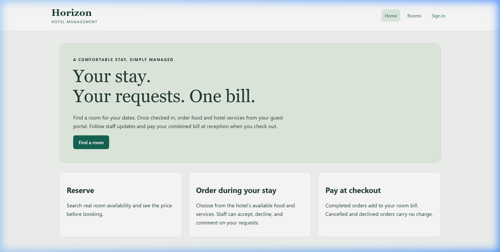
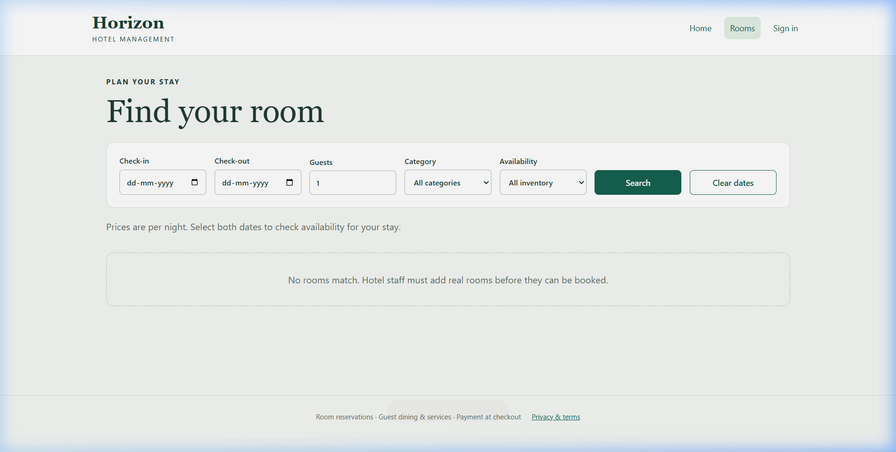
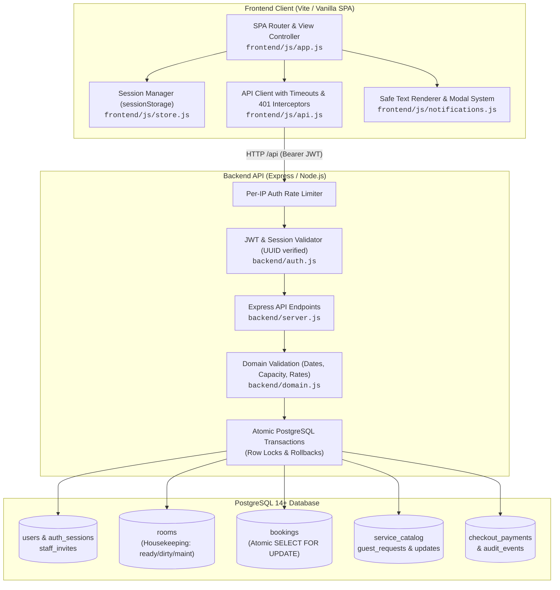
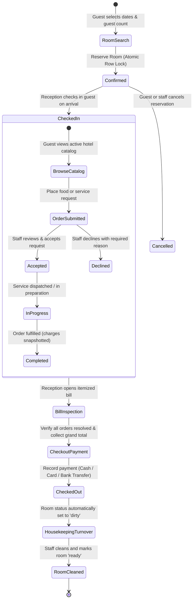
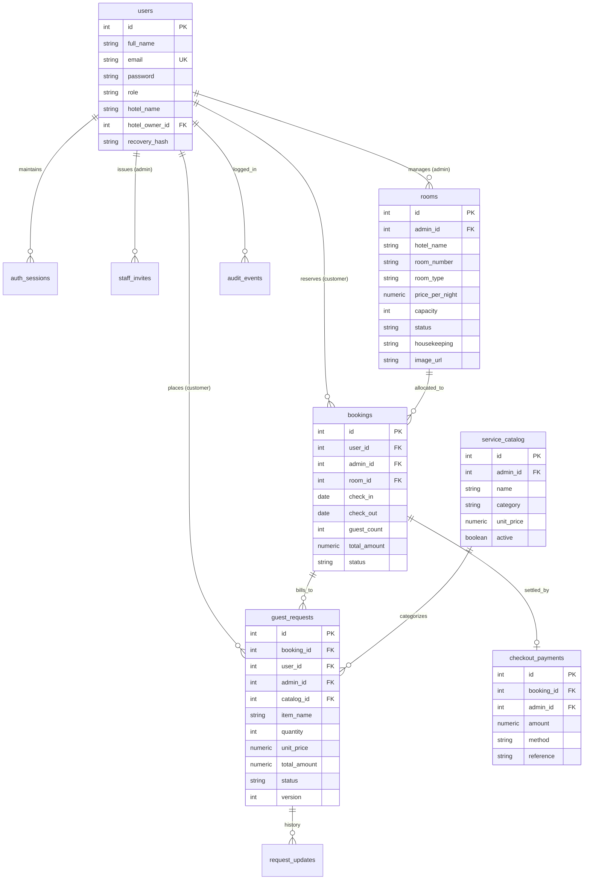

# Grand Horizon — Hotel Management System (HMS)

A full-stack, multi-tenant Hotel Management System engineered with Node.js, Express, PostgreSQL, and a vanilla JavaScript single-page application bundled with Vite. Built with enterprise-grade isolation, date-aware availability calculation, race-condition protected bookings, guest dining/services ordering, and unified checkout billing.

---

## Visual Preview

### Guest Portal & Home


### Real-Time Rooms & Suites Explorer


---

## System Architecture

The following diagram illustrates the component architecture, data flow, and security boundaries across the client, API server, and PostgreSQL database:



---

## Reservation & Unified Billing Lifecycle

The hotel follows a unified billing lifecycle: guests reserve a room, check in, order dining or hotel services during their stay, and pay one consolidated grand total at reception upon departure:



---

## Database Schema & Entity Relationships



---

## Core Features

- **Multi-Tenant Property Isolation**: Each hotel administrator manages their own rooms, catalog, reservations, and staff. Multi-tenancy is strictly enforced by `admin_id` at the database query level.
- **Atomic Booking Protection**: Prevents race conditions and double-bookings using PostgreSQL row-level locks (`SELECT ... FOR UPDATE`) in isolated database transactions.
- **Date-Aware Real-Time Availability**: Availability is computed dynamically against active bookings for any queried calendar date range (`check_in` / `check_out`).
- **In-Stay Dining & Services**: Checked-in guests order meals and amenities directly from their portal. Request lifecycle (`pending` → `accepted` → `in_progress` → `completed` / `declined` / `cancelled`) includes ETAs, staff assignment, and audit logs.
- **Unified Checkout Billing**: Completed food and service orders automatically roll up into the guest's consolidated room bill. Outstanding orders must be resolved before checkout, and declined or cancelled requests never incur charges.
- **Staff Reception Payment Collection**: Reception staff record verified payments (cash, card receipt, bank transfer) and transition the booking to `checked_out`, automatically switching the room to `dirty` for housekeeping turnover.
- **Housekeeping Board**: Independent tracking of room cleanliness (`ready`, `dirty`, `cleaning`, `maintenance`) ensuring rooms are thoroughly sanitized before new guest check-ins.
- **Comprehensive Audit Trail**: Records key staff actions (room changes, request decisions, check-ins, payments) in an immutable activity ledger.

---

## Security Architecture

- **Password Hashing**: Implemented with Node.js async salted Scrypt (16-byte random salt, 64-byte derived key). No plaintext fallbacks exist.
- **Revocable Database-Backed Sessions**: JWT tokens contain an ephemeral session UUID (`sid`) cross-checked against `auth_sessions`. Passwords changes and logouts immediately revoke all active tokens.
- **UUID Format Validation**: Strict regex format validation for all session identifiers prevents SQL parsing faults.
- **Per-IP Rate Limiting**: Exponential cooldown protection on authentication endpoints shields against brute-force attacks.
- **Strict Input Validation**: Exact ISO 8601 calendar date verification (`YYYY-MM-DD`), money format constraints, guest count limits, and HTTPS image URL validation.
- **Safe DOM Rendering**: All notification banners, dialogs, and error messages use `textContent` to eliminate XSS injection risks.

---

## Tech Stack

| Layer | Technology |
|---|---|
| **Frontend** | Vanilla JavaScript (ES Modules), HTML5, Vanilla CSS Design System, Vite 6 |
| **Backend** | Node.js (ESM), Express 4 |
| **Database** | PostgreSQL 14+ with Connection Pooling (`pg`) |
| **Authentication** | JWT (`jsonwebtoken`), Built-in Crypto (`scrypt`), Session Revocation |
| **Testing** | Node.js Built-in Test Runner (`node --test`), Ephemeral PostgreSQL Integration Schemas |

---

## Project Structure

```
t1/
├── backend/
│   ├── auth.js          # Authentication, scrypt hashing, revocable session checks
│   ├── config.js        # Environment configuration
│   ├── db.js            # PostgreSQL connection pool
│   ├── domain.js        # Strict input validation (dates, prices, capacities)
│   ├── migrate.js       # Database migration runner
│   ├── server.js        # Express API routes and transaction handling
│   ├── package.json     # Backend dependencies & scripts
│   ├── database/
│   │   ├── schema.sql   # Core schema (users, rooms, bookings)
│   │   ├── seed.sql     # Demo accounts with scrypt password hashes
│   │   └── migrations/
│   │       └── 001_operations.sql # Operational tables (catalog, orders, billing, audit)
│   └── tests/
│       ├── api.test.js      # Unit tests for domain & auth logic
│       ├── frontend.test.js # DOM safety & script syntax validation
│       └── postgres.test.js # Integration test suite on isolated PostgreSQL schemas
├── frontend/
│   ├── index.html       # Single-page application entry
│   ├── package.json     # Frontend dependencies (Vite)
│   ├── vite.config.js   # Vite configuration & backend proxy
│   ├── css/
│   │   └── app.css      # Luxury theme styling & responsive layout
│   └── js/
│       ├── api.js       # Fetch client with timeouts, 401 handling & base URL resolution
│       ├── app.js       # SPA client router, guest & staff portal controllers
│       ├── notifications.js # Text-safe notification toasts & modals
│       └── store.js     # SessionStorage token & user state manager
├── screenshots/
│   ├── home.png         # Screenshot of the portal homepage
│   └── rooms.png        # Screenshot of rooms & suites explorer
├── ARCHITECTURE.md      # Architecture documentation
├── DESIGN.md            # Visual specification & design tokens
└── README.md
```

---

## Getting Started

### Prerequisites

- **Node.js**: 18.x or newer
- **PostgreSQL**: 14.x or newer

### 1. Database Initialization

Execute the base schema and seed data in your PostgreSQL database (`psql`):

```sql
\i backend/database/schema.sql
\i backend/database/seed.sql
```

Apply operational migrations:

```bash
cd backend
node migrate.js
```

### 2. Configure Environment

Create or edit `backend/.env`:

```env
PORT=8000
PGHOST=localhost
PGPORT=5432
PGUSER=postgres
PGPASSWORD=your-secure-password
PGDATABASE=hms_db
JWT_SECRET=your-secure-random-secret-at-least-32-characters
```

Create or edit `frontend/.env`:

```env
VITE_API_URL=http://localhost:8000/api
```

### 3. Run Application

Start the backend API server:
```bash
cd backend
npm install
npm start # runs API server on port 8000
```

In a separate terminal, launch the frontend client:
```bash
cd frontend
npm install
npm run dev # launches Vite dev server on port 5173
```

Navigate to `http://localhost:5173` in your web browser.

---

## Demo Accounts

Pre-seeded accounts with secure Scrypt hashes for testing:

| Role | Email | Password | Access Capabilities |
|---|---|---|---|
| **Hotel Management** | `admin@horizon.com` | `admin123` | Room management, housekeeping, reservation ledger, orders queue, menu catalog, audit logs |
| **Guest Customer** | `customer@horizon.com` | `guest123` | Room search, atomic reservations, dining/service orders, itemized checkout bill review |

---

## API Reference

All routes are mounted at `/api`.

### Authentication & Access

| Method | Route | Auth | Description |
|---|---|---|---|
| `POST` | `/auth/login` | Public | Authenticates user; returns 8-hour JWT and creates database session |
| `POST` | `/auth/register` | Public | Registers a new guest (or staff member with an invite token) |
| `POST` | `/auth/logout` | Session | Revokes the current session from `auth_sessions` |
| `POST` | `/auth/password` | Session | Changes password and revokes all active sessions for the user |
| `POST` | `/auth/recovery-code` | Session | Generates a single-use private account recovery code |
| `POST` | `/auth/reset` | Public | Resets forgotten password using a private recovery code |
| `GET` | `/auth/me` | Session | Returns current authenticated user profile |

### Rooms & Housekeeping

| Method | Route | Auth | Description |
|---|---|---|---|
| `GET` | `/rooms` | Optional | Queries room inventory; supports `?check_in=&check_out=&room_type=&status=` |
| `POST` | `/rooms` | Staff | Creates a new room under the staff member's hotel |
| `PUT` | `/rooms/:id` | Staff | Updates room category, price, capacity, image, or description |
| `DELETE` | `/rooms/:id` | Staff | Deletes a room (prevented if bookings exist) |
| `PATCH` | `/rooms/:id/housekeeping` | Staff | Updates housekeeping condition (`ready`, `dirty`, `cleaning`, `maintenance`) |

### Bookings & Unified Checkout

| Method | Route | Auth | Description |
|---|---|---|---|
| `GET` | `/bookings` | Session | Lists bookings (scoped to customer's stays or hotel's guests) |
| `POST` | `/bookings` | Guest | Creates atomic reservation with date overlap check and row lock |
| `PATCH` | `/bookings/:id/status` | Session | Advances booking to `checked_in` or `cancelled` |
| `GET` | `/bookings/:id/bill` | Session | Returns itemized bill combining room stay and completed orders |
| `POST` | `/bookings/:id/checkout` | Staff | Records reception payment and checks out guest in a single atomic transaction |

### Food & Service Orders

| Method | Route | Auth | Description |
|---|---|---|---|
| `GET` | `/catalog` | Optional | Returns available dining and hotel service menu items |
| `POST` | `/catalog` | Staff | Adds new item to the property's service catalog |
| `PUT` | `/catalog/:id` | Staff | Updates item name, category, unit price, or availability |
| `GET` | `/requests` | Session | Lists service requests (guest's own or staff's queue) |
| `POST` | `/requests` | Guest | Submits an order for food/service against a checked-in booking |
| `PATCH` | `/requests/:id` | Session | Staff reviews/accepts/completes; guest cancels pending requests |
| `GET` | `/requests/:id/history` | Session | Retrieves chronological update history and staff comments |

### Operations & Diagnostics

| Method | Route | Auth | Description |
|---|---|---|---|
| `GET` | `/staff` | Staff | Lists hotel staff members for order assignment |
| `POST` | `/staff/invites` | Staff | Generates a 24-hour single-use staff invitation token |
| `GET` | `/metrics` | Staff | Real-time KPIs (room count, occupancy %, revenue, arrivals/departures) |
| `GET` | `/audit` | Staff | Retrieves recent immutable staff activity log |
| `GET` | `/health` | Public | System and database health diagnostic |

---

## Running the Automated Test Suite

### Unit & Domain Tests
Runs test cases verifying calendar calculations, password hashing, session UUID validation, XSS prevention, and syntax parsing:

```bash
cd backend
npm test
```

### Full PostgreSQL Integration Test Suite
Executes end-to-end multi-tenant workflows against an isolated, ephemeral PostgreSQL test schema:

```bash
cd backend
$env:HMS_INTEGRATION_TESTS="1"; npm test
```

Integration coverage includes:
- Role & permission boundary enforcement
- Multi-tenant data isolation between different hotels
- Atomic reservation locks preventing double-booking race conditions
- Housekeeping check-in gates and maintenance scheduling
- Service catalog price snapshots and duplicate order mitigation
- Unresolved order checkout blocks and single-payment enforcement
- Database transaction rollbacks on forced errors
- Single-use staff invitations and password recovery tokens